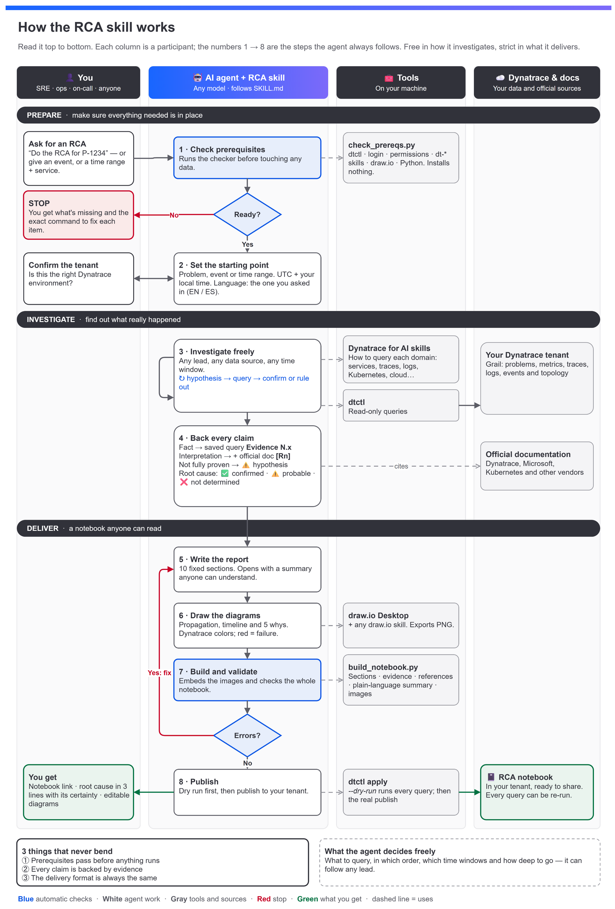
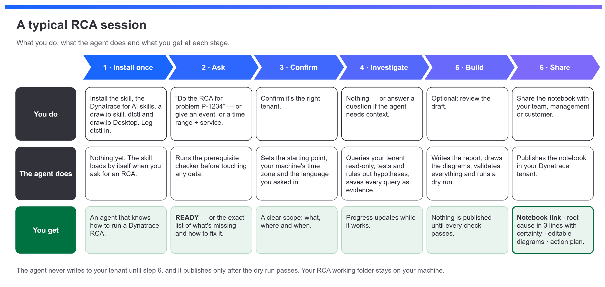

<div align="center">

# Dynatrace RCA Skill for AI Agents

**Ask your AI agent for a root cause analysis.<br>Get back a Dynatrace Notebook that anyone can read, with evidence behind every claim.**

[](https://agentskills.io)
[](https://www.dynatrace.com)
[](https://github.com/dynatrace-oss/dtctl)
[](https://www.python.org)
[](skills/dt-custom-rca-jromero/SKILL.md)
[](#use)
[](LICENSE)

[In short](#in-short) · [How it works](#how-it-works) · [Install](#install) · [Use](#use) · [What you get](#what-you-get) · [User journey](#user-journey) · [Example](examples/rca-example-memory-net/)

</div>

---

## In short

### What it does

`dt-custom-rca-jromero` is an open [Agent Skill](https://agentskills.io). With it, any AI agent can run a root cause analysis on Dynatrace. You give it a problem ID, an event or a time range. It gives you a **ready-to-share RCA notebook inside your Dynatrace tenant** with:

- 📝 **A plain-language summary** that anyone can follow: management, business teams, customers.
- 🔎 **Evidence for every claim.** Each fact links to a saved query you can re-run in the notebook. Each interpretation cites official documentation.
- 🗺️ **Three diagrams in Dynatrace style:** how the failure spread, the timeline and the 5 whys. Red always means failure.
- ✅ **A root cause with its certainty** (confirmed, probable or not determined), plus an action plan with owners, dates and closing criteria.
- 🌐 **In English or Spanish.** The notebook comes out in the language you ask in, or in the one you name.

### The approach

The skill doesn't tell the agent which queries to run. Instead, it sets the standard around the investigation:

1. **Checks prerequisites first:** dtctl, login, permissions, the Dynatrace for AI skills and draw.io. If anything is missing, it stops and tells you how to fix it.
2. **Investigates freely, read-only.** The agent can follow any lead in your tenant, using `dtctl` and the official [Dynatrace for AI](https://github.com/Dynatrace/dynatrace-for-ai) skills.
3. **Backs every claim.** A fact needs a query anyone can re-run, and an interpretation also needs official documentation. Anything without that is labelled a hypothesis.
4. **Delivers in a fixed format.** A validator blocks publishing until the sections, evidence, references, diagrams and plain-language summary are all correct.

It works with any agent that reads skills and can run shell commands, such as Claude Code, OpenAI Codex, GitHub Copilot, Cursor, Kiro, Junie and OpenCode.

> [!NOTE]
> **Language.** Ask in English and you get the notebook in English; ask in Spanish and you get it in Spanish. To pick one explicitly, add "in English" or "en español" to your request. The skill's internal instructions are written in Spanish, but that doesn't affect the output.

---

## How it works

<div align="center">
  
</div>

### Who takes part

| | Participant | Role |
|---|---|---|
| 👤 | **You** | Ask for the RCA, confirm the tenant, then read and share the result. |
| 🤖 | **AI agent + this skill** | Runs the 8 steps. It can be any model: the skill defines what a good RCA looks like, not which queries to run. |
| 🧰 | **Tools on your machine** | `check_prereqs.py` (the gate), `dtctl` (read-only queries and publishing), the Dynatrace for AI skills (how to query each domain), draw.io Desktop (diagrams) and `build_notebook.py` (assembly and validation). |
| ☁️ | **Dynatrace & docs** | Your tenant's data in Grail, plus the official documentation that backs every interpretation. |

### The rules it follows

| When… | The skill… |
|---|---|
| a prerequisite is missing | stops before touching any data and shows the exact command to fix it |
| a dtctl context is active | asks you to confirm it points to the tenant of the incident |
| you ask in English or Spanish | writes the whole notebook in that language, diagrams included, unless you name another one |
| a statement is a **fact** | requires a saved query that can be re-run (`Evidence N.x`) |
| a statement **interprets** behavior | also requires official documentation (`[Rn]`) |
| proof is incomplete | labels it `⚠️ unconfirmed hypothesis` and says what is missing |
| results are truncated or sampled | queries again: no conclusions on partial data |
| the notebook has errors | blocks publishing until they are fixed |
| everything passes | runs a dry run that executes every query, then publishes |

**Root cause certainty:**

- ✅ **Confirmed:** mechanism, timing, documentation and alternatives ruled out.
- ⚠️ **Probable:** one link in that chain is missing.
- ❌ **Not determined.**

📖 Full details (Spanish): [`docs/como-funciona.md`](docs/como-funciona.md)

---

## Install

### 1 · Add the skill

```bash
npx skills add Edunzz/dynatrace_ai_skills_rca
```

The installer finds the skill and asks which agent to install it for. It needs Node.js. To install it manually instead, copy the skill folder into your agent's skills folder:

```bash
git clone https://github.com/Edunzz/dynatrace_ai_skills_rca.git
cp -r dynatrace_ai_skills_rca/skills/dt-custom-rca-jromero ~/.agents/skills/
```

<details>
<summary><b>Skills folder for each agent</b></summary>

| Agent | Project folder | Global folder |
|---|---|---|
| Any agentskills.io-compatible agent | `.agents/skills/` | `~/.agents/skills/` |
| Claude Code | `.claude/skills/` | `~/.claude/skills/` |
| OpenAI Codex | `.codex/skills/` | see the agent's docs |
| GitHub Copilot | `.github/skills/` | see the agent's docs |
| Cursor | `.cursor/skills/` | — |
| Kiro | `.kiro/skills/` | — |
| Junie | `.junie/skills/` | see the agent's docs |
| OpenCode | `.opencode/skills/` | see the agent's docs |

On Windows, `~` is `%USERPROFILE%`. If your agent doesn't support skills, point it to [`AGENTS.md`](AGENTS.md), or ask it to read [`SKILL.md`](skills/dt-custom-rca-jromero/SKILL.md) before starting.

</details>

### 2 · Install the prerequisites

| # | What | How |
|---|---|---|
| R1 | [`dtctl`](https://github.com/dynatrace-oss/dtctl) | macOS/Linux: `brew install dynatrace-oss/tap/dtctl` · Windows: [releases](https://github.com/dynatrace-oss/dtctl/releases) |
| R2 | A dtctl context logged in to your **SaaS** tenant | `dtctl auth login --context <ctx> --environment https://<tenant>.apps.dynatrace.com` |
| R3 | Grail read and document read/write permissions | Granted by your tenant admin |
| R4 | [Dynatrace for AI](https://github.com/Dynatrace/dynatrace-for-ai) skills | `npx skills add dynatrace/dynatrace-for-ai` |
| R5 | Any draw.io skill + draw.io Desktop | `npx skills add jgraph/drawio-mcp --skill drawio` · Windows: `winget install JGraph.Draw` · macOS: `brew install --cask drawio` |
| R7 | Python 3.9+ | [python.org](https://www.python.org/downloads/) |

> [!IMPORTANT]
> Dynatrace **Managed** is not supported, because dtctl only works with Dynatrace SaaS.

### 3 · Check that everything is ready

The checker **installs nothing**. It reviews each prerequisite and, if something is missing, prints the command for your operating system.

```bash
python skills/dt-custom-rca-jromero/scripts/check_prereqs.py          # readable report
python skills/dt-custom-rca-jromero/scripts/check_prereqs.py --json   # for agents
```

```text
[OK]    R1  dtctl                       0.37.0 (...\dtctl.exe)
[OK]    R2  Contexto dtctl              my-tenant -> https://abc12345.apps.dynatrace.com - CONFIRMAR con el usuario...
[OK]    R3  Permisos (scopes)           9/9 obligatorios · 4/4 recomendados
[OK]    R4  Skills Dynatrace for AI     dt-dql-essentials, dt-obs-problems, dt-app-notebooks · dominio: 13/13
[OK]    R5  Skill drawio                drawio
[OK]    R5  draw.io Desktop (CLI)       31.1.8 -> "C:\Program Files\draw.io\draw.io.exe"
[OK]    R7  Python                      3.12.4
[OK]    --  Zona horaria (máquina)      Hora est. Pacífico, Sudamérica (UTC-05:00) - hora local del RCA
RESULTADO: LISTO para iniciar el RCA (confirma el contexto con el usuario).
```

The checker reports in Spanish: `LISTO` means *ready*, `FALTA` means *missing* and `AVISO` is a non-blocking *warning*. Options: `--context <ctx>` checks another dtctl context without switching to it; `--offline` skips the tenant checks. More help (Spanish): [`docs/instalacion.md`](docs/instalacion.md).

---

## Use

Ask your agent in natural language. The notebook comes out in the language you use:

```text
Do the RCA for problem P-1234567                        → notebook in English
Investigate what happened to checkout-service yesterday between 9:00 and 10:00 and build the RCA notebook
Haz el RCA del problema P-1234567                       → notebook in Spanish
Do the RCA for problem P-1234567 in Spanish             → you choose the language
Check the RCA prerequisites
```

Give it at least one starting point: a **problem ID**, an **event ID**, or a **time range plus the affected service**. That is where the investigation starts, not its limit. The agent can widen the time window or bring in other entities whenever the evidence points there.

> [!TIP]
> Times appear in UTC and in **your machine's local time zone**, wherever you are in the world, with daylight saving applied. To investigate a tenant other than your default one, give the agent the dtctl context name.

---

## What you get

### In Dynatrace: the RCA notebook

Every notebook has the same structure. Section 1 and the three diagrams are written for anyone; sections 2 to 9 are for technical teams.

```text
RCA | <Problem ID> | <Service> | <YYYY-MM-DD>
│
├── 0  Cover and incident card             severity · impact window · MTTD/MTTR · certainty
├── 1  Executive summary                   plain language, anyone can read it, 10 lines max
├── 2  Scope and impact
│   ├── 2.1 Affected components            component · role · observed impact
│   ├── 2.2 Impact on users and business   failed requests · users · transactions · SLO
│   └── ▸ Evidence 2.x                     DQL sections you can re-run in the notebook
├── 3  Timeline of events                  D2 diagram · events in UTC + local time · MTTD/MTTR
│   └── ▸ Evidence 3.x
├── 4  Failure propagation diagram         D1 diagram · propagation sequence · blind spots
├── 5  Root cause analysis
│   ├── 5.1 Root cause                     statement · certainty · trigger and factors
│   ├── 5.2 5 whys analysis                D3 diagram · question → answer → evidence
│   ├── 5.3 Hypotheses evaluated           confirmed · ruled out · inconclusive
│   ├── 5.4 Davis validation               does Davis's root cause match the analysis?
│   └── ▸ Evidence 5.x
├── 6  Observability gaps found            gap · effect · recommendation · priority
├── 7  Action plan                         action · owner · due date · closing criteria
├── 8  Lessons learned                     what went well · what to improve · where we got lucky
└── 9  Appendices
    ├── 9.1 Anchor, time windows and evidence
    ├── 9.2 Glossary
    ├── 9.3 Official references            the [Rn] sources cited in the text
    └── 9.4 Version history
```

- **Evidence N.x** blocks are DQL sections with a fixed time window: open one in the notebook and it runs again.
- **[Rn]** marks point to official documentation listed in 9.3.
- Section 5.1 always states the root cause certainty: ✅ confirmed · ⚠️ probable · ❌ not determined.

👉 A complete one: [example notebook](examples/rca-example-memory-net/NOTEBOOK.md)

### In the chat: the agent's final answer

- The notebook's name, ID and link.
- The root cause in 3 lines, with its certainty.
- The paths to the editable `.drawio` diagrams.

### On your machine: the working folder

```text
rca/                      or rca-<Problem ID>/
├── rca_spec.json         language and order of the sections
├── sections/             00-cover.md … 09-appendices.md
├── queries/              E<N.x>-*.dql: the exact queries run with dtctl
├── evidence/             E<N.x>.json results + INDEX.md
├── diagrams/             D1, D2 and D3 as .drawio (editable) and .png
└── notebook.json         the assembled notebook; rebuild it any time with build_notebook.py
```

The folder holds data from your tenant, so keep it private.

---

## User journey

<div align="center">
  
</div>

Here is a real session, end to end. The data comes from the [anonymized example](examples/rca-example-memory-net/).

### 1 · Install once

Add the skill and the prerequisites ([Install](#install)), then run the checker once to make sure everything is ready.

### 2 · Ask

> 👤 **You:** Do the RCA for problem P-2601001.

The agent loads the skill and runs `check_prereqs.py` before touching any data. If something is missing, the session stops here and you get the fix.

### 3 · Confirm

> 🤖 **Agent:** Prerequisites are ready. The active dtctl context `my-tenant` points to `https://abc12345.apps.dynatrace.com`. Is this the tenant of the incident?
>
> 👤 **You:** Yes, go ahead.

The agent sets the starting point (the problem's time window) and your machine's time zone. You asked in English, so the notebook will be in English.

### 4 · Investigate

Everything in this stage is read-only. In the example, the agent:

1. **Started from Davis.** A failure-rate increase on `auth-api`, followed one minute later by a long garbage-collection event.
2. **Tested the obvious hypothesis and ruled it out.** The container had *not* run out of memory: usage peaked at 91% of its limit.
3. **Narrowed it down.** All the failures (9 of ~4,900 requests) came from **one of the two pods**.
4. **Widened the window to 48 hours.** It found a sawtooth pattern: memory grows 75–90 MB per hour until the container restarts, 18 times in 48 hours.
5. **Backed each step.** It saved 12 queries as evidence and cited 4 official sources (Dynatrace, Microsoft .NET and Kubernetes).

### 5 · Build

The agent writes the 10 sections, draws the three diagrams, and then validates the notebook:

```text
$ python build_notebook.py rca_spec.json -o notebook.json --strict
OK: notebook.json | sections: 22 | evidence: 12 | images: 3 (753 KB)

$ dtctl apply -f notebook.json --dry-run      # runs every query, publishes nothing
```

Nothing is published until both commands pass.

### 6 · Share

The agent publishes the notebook and hands you the result. In the example, the root cause was:

> 🤖 **Agent:** Root cause (⚠️ **Probable**): the service's memory grows steadily in every replica. One replica reached 91% of its memory limit, garbage collection took over and requests failed until Kubernetes restarted the container.

Along with it you get the notebook link and the editable `.drawio` diagrams. These are the three diagrams from that notebook:

| D1 · How the failure spread | D2 · Timeline | D3 · 5 whys |
|---|---|---|
| [](examples/rca-example-memory-net/diagrams/D1-propagation.png) | [](examples/rca-example-memory-net/diagrams/D2-timeline.png) | [](examples/rca-example-memory-net/diagrams/D3-root-cause.png) |

The diagrams use Dynatrace's Strato color tokens: 🟥 failure or error · 🟧 degraded · 🟩 healthy · 🟦 change · ⬜ dashed, no visibility.

👉 Read the whole notebook: [`examples/rca-example-memory-net/NOTEBOOK.md`](examples/rca-example-memory-net/NOTEBOOK.md) · Same case in Spanish: [`rca-ejemplo-memoria-net`](examples/rca-ejemplo-memoria-net/NOTEBOOK.md)

---

<details>
<summary><b>Repository layout</b></summary>

```text
dynatrace_ai_skills_rca/
├── skills/
│   └── dt-custom-rca-jromero/      the skill (what gets installed)
│       ├── SKILL.md                instructions for the agent
│       ├── scripts/                check_prereqs.py · build_notebook.py · hora_local.py
│       ├── references/             notebook template, diagram standard, dtctl, evidence, investigation
│       └── assets/                 example spec and draw.io style kit
├── examples/
│   ├── rca-example-memory-net/     anonymized real RCA in English: sections, queries, diagrams, preview
│   └── rca-ejemplo-memoria-net/    the same RCA in Spanish
├── docs/
│   ├── instalacion.md              install guide per agent and OS (Spanish)
│   ├── como-funciona.md            how it works in detail (Spanish)
│   └── images/                     README diagrams (.drawio + .png)
├── AGENTS.md                       instructions for agents without skill support
└── LICENSE
```

</details>

<details>
<summary><b>Privacy</b></summary>

- The published example is **anonymized**. The customer, tenant, services, pods, hosts, entity and problem IDs, and dates were all replaced. Only operational figures that identify no one were kept.
- The working folder of a real RCA (`rca/` or `rca-*/`) holds data from your tenant. `.gitignore` excludes it at the repository root. **Never push it to a public repository.**

</details>

<details>
<summary><b>Contributing</b></summary>

Issues and pull requests are welcome. Before sending a change, make sure both examples still build with no errors or warnings:

```bash
cd examples/rca-example-memory-net
python ../../skills/dt-custom-rca-jromero/scripts/build_notebook.py rca_spec.json -o /tmp/notebook-en.json --strict
cd ../rca-ejemplo-memoria-net
python ../../skills/dt-custom-rca-jromero/scripts/build_notebook.py rca_spec.json -o /tmp/notebook-es.json --strict
```

Any new example data must be anonymized, and a change to one example should be mirrored in the other. The diagrams in `docs/images/` are draw.io files: open the `.drawio` file, or the `.png` itself, since the PNG has the editable diagram embedded.

</details>

**Documentación en español:** [instalación](docs/instalacion.md) · [cómo funciona](docs/como-funciona.md) · [guía de la skill](skills/dt-custom-rca-jromero/README.md)

**License:** [MIT](LICENSE) © Edunzz (Jose Eduardo Romero Jimenez)
