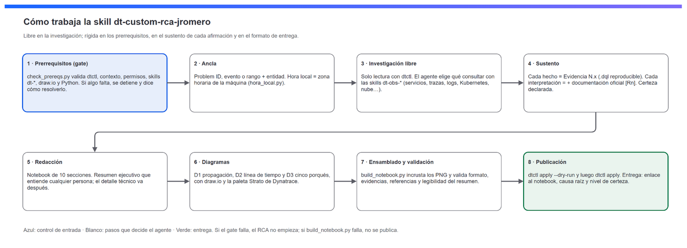

# Cómo funciona la skill

## La idea

La skill no le dice al agente qué queries ejecutar. Es un **estándar** que se monta sobre las skills oficiales [Dynatrace for AI](https://github.com/Dynatrace/dynatrace-for-ai) y fija tres cosas:

1. **Prerrequisitos.** Sin ellos el RCA no empieza.
2. **Sustento.** Cada afirmación tiene evidencia reproducible y, si interpreta un comportamiento, documentación oficial.
3. **Formato de entrega.** El resultado es un notebook de Dynatrace con estructura, diagramas y validaciones fijas.

Todo lo demás lo decide el agente: qué fuentes consultar, en qué orden, qué ventanas de tiempo usar y cuánto profundizar.

**Jerarquía de autoridad** (si hay conflicto, gana la primera):

1. La documentación oficial y `dtctl <comando> --help`.
2. Las skills oficiales Dynatrace for AI.
3. Esta skill.

## Paso a paso

### 1. Prerrequisitos (gate)
`scripts/check_prereqs.py` revisa, sin instalar nada:

- **R1:** `dtctl`.
- **R2:** el contexto, con `dtctl doctor`. Detecta Dynatrace Managed y oculta el token.
- **R3:** los scopes, con `--check-scopes`: 9 obligatorios y 4 recomendados.
- **R4:** las skills `dt-*`. Las busca en las carpetas de skills de todos los agentes compatibles.
- **R5:** cualquier skill de draw.io y el CLI de draw.io Desktop. Prueba candidatos y se queda con el primero que responde.
- **R7:** Python 3.9 o superior.
- **Zona horaria de la máquina** (informativa).

Si algo da `FALTA`, el agente se detiene y muestra los comandos para resolverlo. El agente siempre confirma con el usuario que el contexto apunta al tenant del incidente.

### 2. Ancla
El punto de partida es un Problem ID, un ID de evento, o un rango de tiempo más una entidad. Es el inicio de la investigación, no su límite. Toda ventana adicional que se use se registra en el anexo 9.1.

La **hora local** es la zona horaria de la máquina donde corre el agente. `scripts/hora_local.py` convierte cada hora UTC con el desfase vigente en esa fecha, horario de verano incluido.

### 3. Investigación libre
La investigación es de solo lectura sobre el tenant. `references/senales-y-skills.md` relaciona cada pregunta del RCA con la skill que conviene cargar. `references/lineamientos-investigacion.md` resume:

- **Principios:** Davis orienta pero no concluye; correlación no es causalidad; siempre comparar contra el baseline.
- **Checklist de cobertura.**
- **Técnicas:** 5 porqués, tabla de hipótesis, comparar trazas sanas contra fallidas, `dtctl inventory`.
- **Antipatrones.**

### 4. Sustento
| Tipo de afirmación | Sustento requerido |
|---|---|
| Hecho observado | Evidencia del tenant: una query `.dql` guardada, validada con `dtctl verify` y con ventana absoluta |
| Interpretación de Dynatrace o de la tecnología | Lo anterior + documentación oficial citada como `[Rn]` |
| Relación causal | Secuencia temporal + mecanismo + documentación + hipótesis alternativas descartadas |
| Sin sustento completo | Se marca `⚠️ Hipótesis no confirmada` y se indica qué falta |

**Nivel de certeza de la causa raíz:**
- ✅ **Confirmada:** mecanismo, tiempo, documentación y alternativas descartadas.
- ⚠️ **Probable:** falta un eslabón.
- ❌ **No determinada.**

No se concluye sobre resultados truncados o muestreados.

### 5. Redacción
La plantilla obligatoria está en `references/formato-notebook.md`: 10 secciones con títulos, tablas e indicadores fijos. Se puede agregar contenido, pero no quitar.

El **resumen ejecutivo** debe entenderlo cualquier persona:
- Sin código, DQL, IDs ni siglas técnicas.
- Los componentes se nombran por su función de negocio.
- El impacto se expresa en personas, operaciones o minutos.
- Máximo 10 líneas.

### 6. Diagramas
Los diagramas se hacen con draw.io a partir del kit `assets/drawio/rca-kit-dynatrace.drawio`. El estándar está en `references/drawio-diagramas.md`.

| Diagrama | Qué muestra |
|---|---|
| D1 — Propagación | Capas de consumidores → servicios → infraestructura, con flechas rojas numeradas por hora |
| D2 — Línea de tiempo | Sucesos coloreados por tipo, franja de impacto y medidas MTTD y MTTR |
| D3 — 5 porqués | Cadena causal, causa raíz, factores contribuyentes y mitigantes, e hipótesis descartadas |

**Paleta (tokens Strato de Dynatrace, tema claro):**

| Estado | Relleno / borde |
|---|---|
| Causa raíz | `#e01032` / `#c80026`, borde grueso y etiqueta CAUSA RAÍZ |
| Con errores | `#faeae9` / `#c80026` |
| Degradado | `#fdf3dd` / `#d56b1a` |
| Sano | `#eaf4ee` / `#007242` |
| Cambio | `#e7eefb` / `#0b56e5` |
| Sin visibilidad | `#f4f4f6` / `#5c5d66`, punteado |
| Marca (solo la banda superior) | `#1966ff` → `#7d6afa` |

El color nunca es la única señal: también se usan el borde grueso, el punteado y el texto tachado. Cada diagrama lleva un título simple, una línea "cómo leer este diagrama" y una leyenda.

### 7. Ensamblado y validación
`scripts/build_notebook.py` arma el JSON del notebook a partir de un spec: secciones markdown y queries `.dql`. También incrusta los PNG en base64 y repara los PNG truncados por versiones antiguas de draw.io.

**Errores (bloquean la publicación):**
- Formato:
  - Nombre del notebook.
  - Portada.
  - 19 títulos y subsecciones obligatorios.
  - HTML o imágenes externas.
  - Un diagrama por sección 3, 4 y 5.
  - Ventana de tiempo absoluta.
  - Nivel de certeza declarado.
- Sustento:
  - Toda "Evidencia N.x" citada existe como sección DQL.
  - Toda referencia `[Rn]` existe en la tabla 9.3.
- Lectura del resumen ejecutivo:
  - Máximo 10 líneas.
  - Sin código, DQL ni IDs de entidad.

**Advertencias** (con `--strict` también bloquean):
- Jerga técnica en el resumen.
- Placeholders sin reemplazar.
- Evidencias o referencias que no se citan.
- Imágenes pesadas.

### 8. Publicación
Primero `dtctl apply -f notebook.json --dry-run`, que ejecuta todas las queries contra el tenant sin publicar nada. Después `dtctl apply`.

La respuesta final al usuario incluye el enlace al notebook, la causa raíz en tres líneas con su nivel de certeza y los `.drawio` fuente. Para actualizar un RCA ya publicado, se descarga primero (`dtctl get notebook <id> -o json`) y se modifica ese archivo.

## Archivos de la skill

| Archivo | Para qué |
|---|---|
| `SKILL.md` | Instrucciones que carga el agente |
| `scripts/check_prereqs.py` | Gate de prerrequisitos |
| `scripts/build_notebook.py` | Ensamblado y validación del notebook |
| `scripts/hora_local.py` | Conversión de UTC a la hora local de la máquina |
| `references/formato-notebook.md` | Plantilla obligatoria y reglas por audiencia |
| `references/drawio-diagramas.md` | Estándar visual y estilos exactos de draw.io |
| `references/dtctl-lineamientos.md` | Uso seguro y trazable de dtctl |
| `references/senales-y-skills.md` | Mapa de pregunta del RCA → skill de Dynatrace |
| `references/fuentes-oficiales.md` | Estándar de sustento y citación |
| `references/lineamientos-investigacion.md` | Principios, checklist, técnicas y antipatrones |
| `assets/drawio/rca-kit-dynatrace.drawio` | Kit visual (vista previa en `.png`) |
| `assets/rca_spec.example.json` | Ejemplo de spec |

## Modelos y agentes

- Funciona con cualquier agente que lea skills (o `AGENTS.md`) y pueda ejecutar comandos.
- Los scripts solo usan la biblioteca estándar de Python y funcionan en Windows, macOS y Linux.
- Los mejores resultados se obtienen con modelos que razonan bien en tareas largas y que pueden ver imágenes, para la revisión visual de los diagramas. Si el modelo no tiene visión, la skill pide validar la estructura del diagrama y dejar la revisión visual al usuario.
