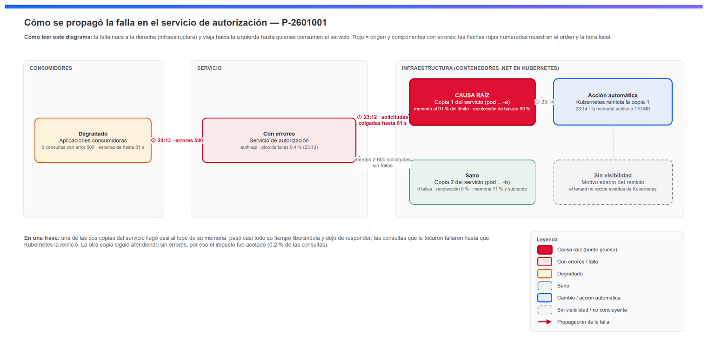
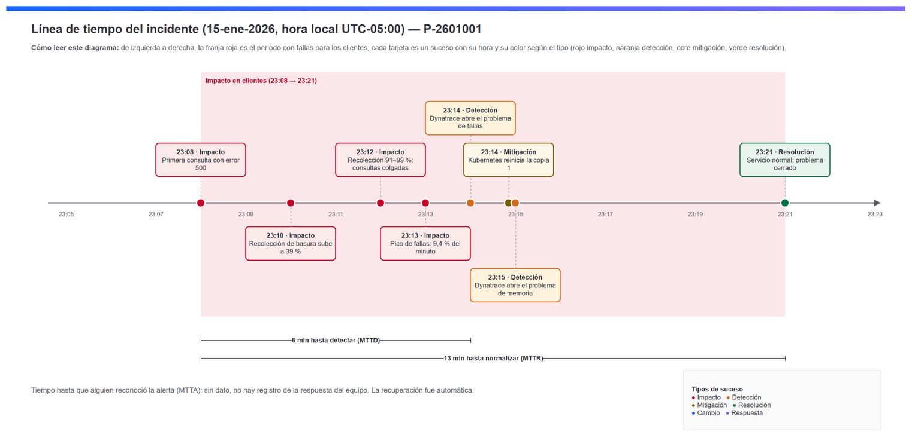
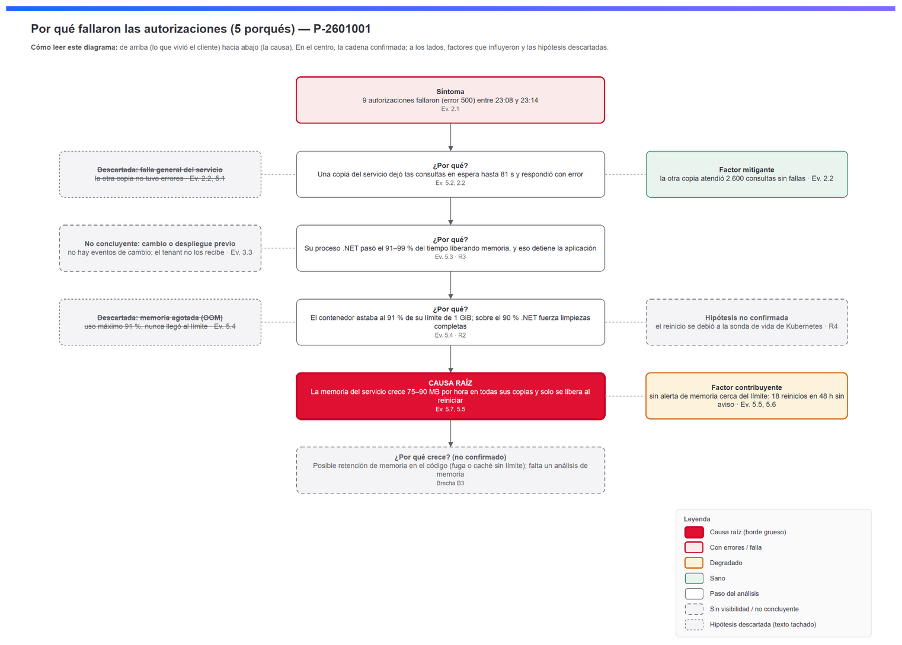

# Ejemplo: RCA de fallas por presión de memoria en un servicio .NET

RCA **real** generado con la skill `dt-custom-rca-jromero` sobre un tenant Dynatrace SaaS y luego **anonimizado** para publicarlo. Muestra lo que produce la skill de principio a fin.

El mismo caso en inglés está en [`rca-example-memory-net`](../rca-example-memory-net/).

> **Datos anonimizados.** Se reemplazaron el cliente, el tenant, los nombres de servicios, pods y procesos, los IDs de entidades, eventos y problemas, y las fechas. Se conservaron las cifras operativas (solicitudes, porcentajes, memoria, tiempos), que no identifican a nadie. Las queries usan IDs ficticios: sirven como referencia, pero no devuelven datos en tu tenant.

## El caso en una frase

Una de las dos copias de un servicio de autorización (.NET en Kubernetes) llegó al 91 % de su límite de memoria. Pasó casi todo su tiempo en recolección de basura y dejó de responder: 9 de unas 4.900 consultas fallaron hasta que Kubernetes reinició el contenedor. La causa de fondo: la memoria del servicio crece entre 75 y 90 MB por hora en todas sus copias. **Certeza: ⚠️ Probable.**

## Qué se le pidió al agente

> "Haz un RCA de prueba simple en el tenant `<contexto>`. Elige un problema Davis reciente y sencillo."

El agente siguió el flujo de la skill:

1. **Prerrequisitos:** el gate dio LISTO y el usuario confirmó el contexto.
2. **Ancla:** eligió un problema de "aumento de fallas" con una sola entidad afectada, y un problema relacionado de "GC larga" un minuto después.
3. **Investigación:**
   - Descartó la hipótesis inicial de que la memoria del contenedor se hubiera agotado: el uso máximo fue 91 %.
   - Encontró que todas las fallas venían de una sola copia.
   - Amplió la ventana a 48 h y descubrió el patrón en sierra: la memoria crece hasta casi el límite y cae con cada reinicio (18 reinicios en 48 h).
4. **Sustento:** 12 queries de evidencia y 4 referencias oficiales (Dynatrace, Microsoft .NET y Kubernetes).
5. **Ensamblado y publicación:** `build_notebook.py --strict` y `dtctl apply --dry-run` pasaron sin errores, y el notebook se publicó.

## Contenido

| Ruta | Qué es |
|---|---|
| [`NOTEBOOK.md`](NOTEBOOK.md) | **Vista previa del notebook completo** en Markdown: las 10 secciones, los diagramas y las queries |
| [`rca_spec.json`](rca_spec.json) | Orden de secciones y evidencias (entrada de `build_notebook.py`) |
| [`sections/`](sections/) | Las 10 secciones en Markdown (`00-portada.md` … `09-anexos.md`) |
| [`queries/`](queries/) | Las 12 queries de evidencia `E<N.x>-*.dql`, con ventana absoluta |
| [`diagrams/`](diagrams/) | D1, D2 y D3 en `.drawio` (editables) y `.png` (con el XML incrustado) |
| [`evidence/INDEX.md`](evidence/INDEX.md) | Índice de evidencia. Los resultados crudos `E<N.x>.json` se omiten porque contienen datos del tenant |

## Diagramas

**D1 — Cómo se propagó la falla**


**D2 — Línea de tiempo**


**D3 — 5 porqués**


## Volver a ensamblarlo

```bash
cd examples/rca-ejemplo-memoria-net
python ../../skills/dt-custom-rca-jromero/scripts/build_notebook.py rca_spec.json -o notebook.json --strict
# OK: notebook.json | secciones: 22 | evidencias: 12 | imágenes: 3
```

Para publicarlo en tu tenant como demostración: `dtctl apply -f notebook.json --context <tu-contexto>`. Las secciones DQL no devolverán datos porque usan IDs ficticios.

Para un RCA propio, no copies este ejemplo. Pídele al agente el RCA de tu problema y la skill genera la carpeta de trabajo completa.
