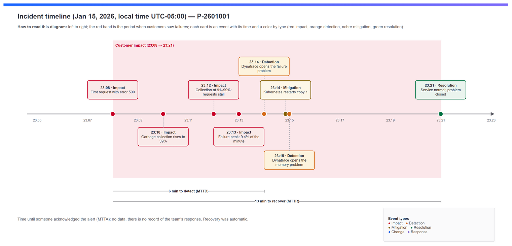
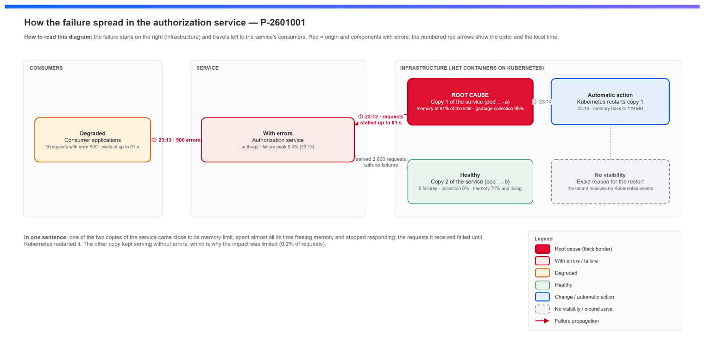
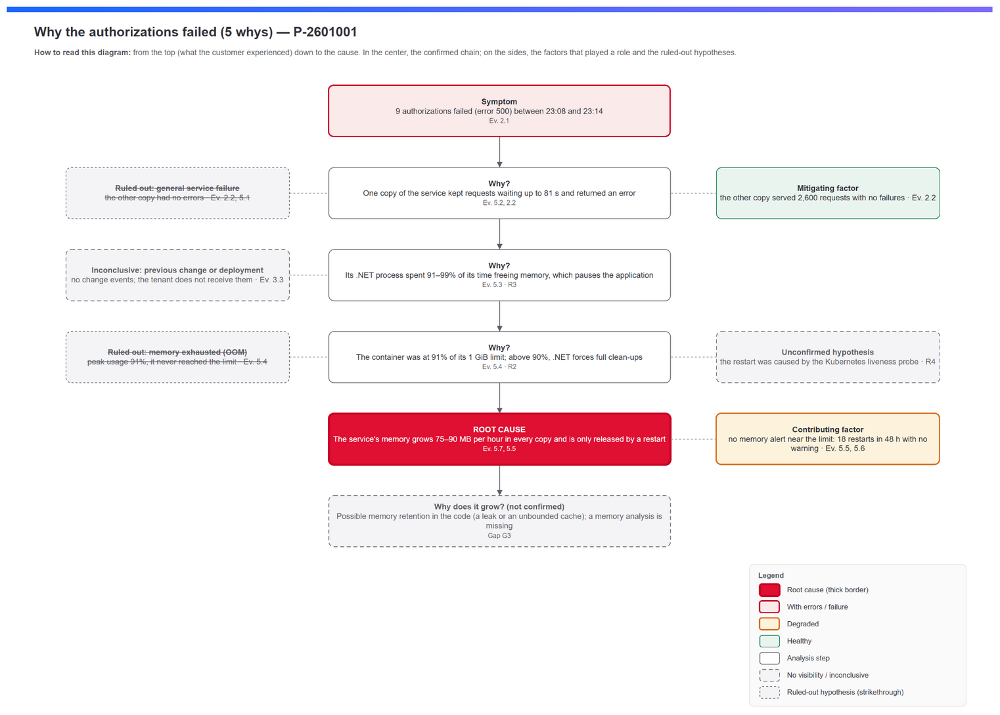

<!-- Generated from rca_spec.json: Markdown preview of the notebook. -->
> **Preview of the generated notebook.** In Dynatrace each `[Evidence N.x]` block is a DQL section that runs and shows its chart or table; here you see the query. Anonymized data.

# RCA — Authorization service failures caused by memory pressure (example)
**Customer / Application:** Example company — authorization service · **Environment:** example tenant · **Document version:** 1.0 · **RCA status:** Draft (example from the dt-custom-rca-jromero skill)

| Field | Value |
|---|---|
| Problem ID | [P-2601001](/ui/apps/dynatrace.davis.problems/problem/1000000000000000001_1768536540000V2) (related: [P-2601002](/ui/apps/dynatrace.davis.problems/problem/1000000000000000002_1768536720000V2)) |
| ITSM ticket | N/A (no ticket was opened) |
| Severity | 🟡 Medium |
| Davis category | ERROR (related: RESOURCE_CONTENTION) |
| Impact start | 2026-01-16 04:08 UTC (23:08 local time on Jan 15) |
| Impact end | 2026-01-16 04:21 UTC (23:21 local time on Jan 15) |
| Impact duration | 13 min |
| Local time zone | SA Pacific Standard Time (UTC-05:00) — the time zone of the machine where the RCA was prepared |
| MTTD / MTTR | 6 min / 13 min |
| Root cause component | .NET process AuthApi.dll in pod auth-api-v1-5f7c9d8b6-pod-a |
| Root cause certainty | ⚠️ Probable |
| Investigation anchor | Problem P-2601001 (example case) |
| Prepared by | Example author — AI-assisted (dt-custom-rca-jromero skill) |
| Reviewed by | Pending |
| Date prepared | 2026-01-16 |

---

## 1. Executive summary
On January 15 between 23:08 and 23:21 (local time), the service that authorizes requests from the applications returned errors for some of them. **9 of about 4,900 requests (0.2%)** failed, some after waiting more than a minute; the rest were served normally.
- **Why it happened (root cause, ⚠️ Probable):** one of the two copies of the service ran almost out of available memory and spent nearly all its time trying to free it, so it stopped responding in time.
- **What triggered it:** that copy's memory had been growing steadily for hours until it reached 91% of its limit.
- **How we recovered:** the platform automatically restarted that copy at 23:14, and by 23:21 the service was working normally.
- **How we found out:** Dynatrace detected it automatically 6 minutes after the first failure.
- **Where things stand:** resolved, but the pattern keeps repeating: in the last 48 hours the service's copies restarted 18 times with the same memory growth.
- **What we'll do so it doesn't happen again:** fix the service's memory consumption (Jan 29), alert before memory reaches the limit (Jan 22) and record the platform's events (Jan 29).

## 2. Scope and impact
### 2.1 Affected components
| Component | Type | Role in the incident | Observed impact | Evidence |
|---|---|---|---|---|
| auth-api-v*-* | Service | Affected (symptom) | Failure rate 0% → **9.43%** in the 04:13 UTC minute (Davis reported 2.07% over its window) | Evidence 2.1 |
| Pod auth-api-v1-5f7c9d8b6-pod-a | Pod / .NET process | Origin | **9 of 2,298** requests failed (0.39%); GC 5% → **99%**; memory at **91%** of the limit | Evidence 2.2, 5.3 and 5.4 |
| Pod auth-api-v1-5f7c9d8b6-pod-b | Pod / .NET process | Not affected | 0 of 2,600 requests failed; GC 0% | Evidence 2.2 |
### 2.2 Impact on users and business
| Dimension | Value | Source |
|---|---|---|
| Failed requests | **9 of 4,863 (0.19%)** between 03:45 and 04:45 UTC; all with HTTP 500 | Evidence 2.1 |
| Wait time of the failed requests | up to **81 s** before returning an error | Evidence 5.2 |
| Affected users / sessions | N/A — Davis reports no affected users for this problem | Evidence 3.2 |
| Lost business transactions | N/A — there are no business events for this flow | N/A |
| Affected SLO | N/A — not evaluated in this example | N/A |

<details><summary><b>[Evidence 2.1] Requests, failures and failure rate per minute for the service</b> (DQL section)</summary>

```dql
timeseries {
  requests = sum(dt.service.request.count),
  failures = sum(dt.service.request.failure_count)
}, filter: dt.smartscape.service == toSmartscapeId("SERVICE-0123456789ABCDEF"),
   from: "2026-01-16T03:45:00Z", to: "2026-01-16T04:45:00Z", interval: 1m
| fieldsAdd failure_rate_pct = failures[] * 100.0 / requests[]
```
</details>

<details><summary><b>[Evidence 2.2] Requests and failures by pod</b> (DQL section)</summary>

```dql
fetch spans, from: "2026-01-16T03:45:00Z", to: "2026-01-16T04:45:00Z"
| filter dt.smartscape.service == toSmartscapeId("SERVICE-0123456789ABCDEF") and request.is_root_span == true
| fieldsAdd m = coalesce(1 / ((power(2, 56) - coalesce(sampling.threshold, 0)) * power(2, -56)), 1) * coalesce(aggregation.count, 1)
| summarize {requests = sum(m), failed = sum(if(request.is_failed == true, m, else: 0))}, by: {k8s.pod.name}
| fieldsAdd failure_rate_pct = failed * 100.0 / requests
| sort failed desc
```
</details>

## 3. Timeline of events

*Figure 1. Incident timeline (local time, UTC-05:00): failures began when copy 1 was spending almost all its time freeing memory, and ended after its automatic restart.*

| # | UTC time | Local time (UTC-05:00) | Event | Type | Source |
|---|---|---|---|---|---|
| 1 | 2026-01-16 04:08 | 23:08 | First failed request (HTTP 500) on pod …-a (copy 1); GC at 11.8% | Impact | Evidence 2.1 and 5.2 |
| 2 | 2026-01-16 04:10 | 23:10 | GC time on pod …-a (copy 1) rises to 39.5% | Impact | Evidence 5.3 |
| 3 | 2026-01-16 04:12 | 23:12 | GC at 91%: Davis records the long GC event; requests stall for up to 81 s | Impact | Evidence 5.3, 3.1 and 5.2 |
| 4 | 2026-01-16 04:13 | 23:13 | Failure peak: 9.43% of the requests in that minute | Impact | Evidence 2.1 |
| 5 | 2026-01-16 04:14 | 23:14 | Davis opens P-2601001 (failure rate increase) | Detection | Evidence 3.2 |
| 6 | 2026-01-16 04:14 | 23:14 | Restart of container dotnet-container on pod …-a (copy 1) (process restart event at 04:14:51) | Mitigation | Evidence 3.1 and 5.5 |
| 7 | 2026-01-16 04:15 | 23:15 | Davis opens P-2601002 (long GC); GC time drops back to 0% | Detection | Evidence 3.2 and 5.3 |
| 8 | 2026-01-16 04:21 | 23:21 | Failure events close; service back to normal | Resolution | Evidence 3.1 and 2.1 |

| Indicator | Value | Calculation |
|---|---|---|
| MTTD | 6 min | Detection (04:14) − Impact start (04:08) |
| MTTA | N/A | No record of the team acknowledging the problem (see G4) |
| MTTR | 13 min | Resolution (04:21) − Impact start (04:08) |

<details><summary><b>[Evidence 3.1] Davis events for both problems</b> (DQL section)</summary>

```dql
fetch dt.davis.events, from: "2026-01-16T03:45:00Z", to: "2026-01-16T04:45:00Z"
| filter in(event.id, {"1000000000000000001_1768536540000", "1000000000000000003_1768536540000", "1000000000000000004_1768536891970", "1000000000000000002_1768536720000"})
| fields event.start, event.end, event.name, event.type, k8s.pod.name, host.name, event.description
| sort event.start asc
```
</details>

<details><summary><b>[Evidence 3.2] Davis problems P-2601001 and P-2601002</b> (DQL section)</summary>

```dql
fetch dt.davis.problems, from: "2026-01-16T03:45:00Z", to: "2026-01-16T04:45:00Z"
| filter in(display_id, {"P-2601001", "P-2601002"}) and not(dt.davis.is_duplicate)
| fields display_id, event.start, event.end, event.name, event.category, root_cause_entity_name, smartscape.affected_entity.ids
| sort event.start asc
```
</details>

<details><summary><b>[Evidence 3.3] Events recorded in the tenant by kind (24 h)</b> (DQL section)</summary>

```dql
fetch events, from: "2026-01-15T04:45:00Z", to: "2026-01-16T04:45:00Z"
| summarize {event_count = count(), change_event_count = countIf(contains(toString(event.type), "DEPLOY") or contains(toString(event.type), "CONFIG") or contains(toString(event.kind), "K8S"))}, by: {event.kind}
| sort event_count desc
```
</details>

## 4. Failure propagation diagram

*Figure 2. How the failure spread: one copy of the service came close to its memory limit, stopped responding and its requests failed; the other copy stayed healthy. Red: root cause and components with errors · Orange: degraded · Green: healthy · Dashed gray: no visibility.*

**Propagation sequence**
1. **23:12 — Copy 1 (pod …-a):** with container memory at 91% of the limit, the .NET process spends 91–99% of its time in GC and its requests stall for up to 81 s (Evidence 5.3, 5.4 and 5.2).
2. **23:13 — Authorization service:** the requests handled by that copy end with HTTP 500; the service's failure rate reaches 9.43% in that minute (Evidence 2.1 and 5.1).
3. **23:13–23:14 — Consumers:** get an error on 9 authorizations (Evidence 2.1).
4. **23:14 — Recovery:** Kubernetes restarts the container, GC drops back to 0% and the service is back to normal at 23:21 (Evidence 5.5 and 5.3).

**Relevant unaffected components:** copy 2 (pod …-b) with 0 failures, GC at 0% and memory at 71% of the limit (Evidence 2.2, 5.3 and 5.4); Davis recorded no other affected entities (Evidence 3.2).
**Blind spots:** the exact reason for the restart (the tenant receives no Kubernetes events) and the service's consumers, not identified in this example (see G1).

## 5. Root cause analysis
### 5.1 Root cause
> **The authorization service keeps accumulating memory (75–90 MB per hour in each copy) until it nears the container's 1 GiB limit; above 90%, .NET garbage collection takes up almost all of the process's time, the application stalls and requests fail until the container restarts.**

**Certainty level:** ⚠️ Probable — the mechanism is confirmed by evidence (memory at 91% → GC at 91–99% → failures only on that copy → restart → recovery) and the pattern repeats over 48 h; still missing: what holds on to the memory (memory analysis, G3) and the exact reason for the restart (no Kubernetes events, G1).

| Classification | Description | Evidence | Official reference |
|---|---|---|---|
| Trigger | Copy 1 reached 936 MB (91% of the 1 GiB limit) and its GC time went from 15% to 99% between 04:09 and 04:14 UTC | Evidence 5.4 and 5.3 | [R2] |
| Root cause | Continuous memory growth of the .NET process (75–90 MB/h) in every copy, released only by a restart | Evidence 5.7 and 5.5 | [R2] |
| Contributing factor | GC suspends the application's threads, so in-flight requests waited for up to 81 s | Evidence 5.2 | [R3] |
| Contributing factor | No early-warning alert on memory versus the limit: 18 restarts in 48 h and repeated problems over 7 days | Evidence 5.5 and 5.6 | — |
| Mitigating factor | Copy 2 served 2,600 requests without failures and the affected copy restarted on its own | Evidence 2.2 and 5.5 | — |

### 5.2 5 whys analysis

*Figure 3. 5 whys tree: authorizations failed because one copy of the service, almost out of free memory, spent most of its time freeing it; the service's memory grows steadily in every copy.*

| # | Question | Answer | Evidence | Official reference |
|---|---|---|---|---|
| 1 | Why did 9 authorizations fail? | Copy 1 kept requests waiting for up to 81 s and returned HTTP 500; the other copy did not fail | Evidence 2.1, 2.2 and 5.2 | — |
| 2 | Why did the requests stall? | The .NET process spent 91–99% of its time in GC, which suspends the application's threads | Evidence 5.3 | [R3] |
| 3 | Why so much GC? | The container was at 91% of its 1 GiB limit; .NET treats that limit as physical memory and above 90% runs more aggressive full collections | Evidence 5.4 | [R2] |
| 4 | Why was it so close to the limit? | Memory grows 75–90 MB per hour in every copy and only drops on restart (18 restarts in 48 h) | Evidence 5.7 and 5.5 | — |
| 5 | Why does memory grow? | ⚠️ Unconfirmed hypothesis: objects retained in the code (a leak or an unbounded cache); it needs a memory analysis of the process | N/A (G3) | — |
"—" is only valid for observed facts; every interpretation needs an official reference.

### 5.3 Hypotheses evaluated
| # | Hypothesis | For (Evidence) | Against (Evidence) | Official reference | Status |
|---|---|---|---|---|---|
| H1 | Memory pressure on copy 1 → excessive GC → failures | Failures only on copy 1 (Ev. 2.2); GC 91–99% (Ev. 5.3); memory 91% (Ev. 5.4) | — | [R2], [R3] | ✅ Confirmed |
| H2 | General failure of the service or its dependencies | — | Copy 2 had no failures and GC at 0% (Ev. 2.2, 5.1) | — | ❌ Ruled out |
| H3 | Container killed for running out of memory (OOM) | Restart at 04:14 (Ev. 5.5) | Peak usage 91%, it never reached the limit (Ev. 5.4) | — | ❌ Ruled out |
| H4 | A previous deployment or configuration change | — | No change events in 24 h, but the tenant does not receive them (Ev. 3.3) | — | ⚠️ Inconclusive |
| H5 | The Kubernetes liveness probe triggered the restart while the process was suspended | The restart matches GC at 99% (Ev. 5.3, 5.5) | No Kubernetes event with the reason | [R4] | ⚠️ Unconfirmed hypothesis |

### 5.4 Davis validation
- **Root cause entity proposed by Davis:** the service auth-api-v*-* (P-2601001) and, in a separate problem, the AuthApi.dll process group (P-2601002) (Evidence 3.2).
- **Matches the confirmed root cause:** Partially — Davis pointed to the service (the symptom) and, separately, to the process's GC (the mechanism); it kept them as two problems, while the analysis shows a single causal chain on copy 1.
- **How Davis determines the root cause:** it correlates events that share the same root cause into a single problem and ranks the most likely anomaly as the origin [R1].

<details><summary><b>[Evidence 5.1] Requests and failures by pod and minute</b> (DQL section)</summary>

```dql
fetch spans, from: "2026-01-16T03:45:00Z", to: "2026-01-16T04:45:00Z"
| filter dt.smartscape.service == toSmartscapeId("SERVICE-0123456789ABCDEF") and request.is_root_span == true
| makeTimeseries {requests = count(), failed = countIf(request.is_failed == true)}, by: {k8s.pod.name}, interval: 1m
```
</details>

<details><summary><b>[Evidence 5.2] Details of the failed requests</b> (DQL section)</summary>

```dql
fetch spans, from: "2026-01-16T03:45:00Z", to: "2026-01-16T04:45:00Z"
| filter dt.smartscape.service == toSmartscapeId("SERVICE-0123456789ABCDEF") and request.is_root_span == true and request.is_failed == true
| fields start_time, k8s.pod.name, endpoint.name, http.response.status_code, duration, dt.failure_detection.results, trace.id
| sort start_time asc
```
</details>

<details><summary><b>[Evidence 5.3] Time in garbage collection (.NET) by process</b> (DQL section)</summary>

```dql
timeseries gc_time_pct = avg(dt.runtime.clr.gc.time_percentage),
   by: {dt.smartscape.process, k8s.pod.name},
   from: "2026-01-16T03:45:00Z", to: "2026-01-16T04:45:00Z", interval: 1m
| filter in(dt.smartscape.process, {toSmartscapeId("PROCESS-0123456789ABC00A"), toSmartscapeId("PROCESS-0123456789ABC00B")})
| fieldsAdd gc_max_pct = arrayMax(gc_time_pct)
```
</details>

<details><summary><b>[Evidence 5.4] Container memory versus the limit by pod</b> (DQL section)</summary>

```dql
timeseries {
  memory_ws = avg(dt.kubernetes.container.memory_working_set),
  memory_limit = avg(dt.kubernetes.container.limits_memory)
}, by: {k8s.pod.name, k8s.container.name},
   from: "2026-01-16T03:45:00Z", to: "2026-01-16T04:45:00Z", interval: 1m
| filter contains(k8s.pod.name, "auth-api") and k8s.container.name == "dotnet-container"
| fieldsAdd ws_max_mb = arrayMax(memory_ws) / 1048576, limit_mb = arrayMax(memory_limit) / 1048576
| fieldsAdd max_usage_pct = ws_max_mb * 100.0 / limit_mb
```
</details>

<details><summary><b>[Evidence 5.5] Container restarts by pod (48 h)</b> (DQL section)</summary>

```dql
timeseries restarts = sum(dt.kubernetes.container.restarts),
   by: {k8s.pod.name, k8s.container.name},
   from: "2026-01-14T04:45:00Z", to: "2026-01-16T04:45:00Z", interval: 1h
| filter contains(k8s.pod.name, "auth-api")
| fieldsAdd total_restarts_48h = arraySum(restarts)
| sort total_restarts_48h desc
```
</details>

<details><summary><b>[Evidence 5.6] Recurrence of the service's problems (7 days)</b> (DQL section)</summary>

```dql
fetch dt.davis.problems, from: "2026-01-09T04:45:00Z", to: "2026-01-16T04:45:00Z"
| filter not(dt.davis.is_duplicate)
| filter in(root_cause_entity_id, {"SERVICE-0123456789ABCDEF", "PROCESS_GROUP-0123456789ABCDEF"})
| summarize {problems = count(), first_seen = min(event.start), last_seen = max(event.start)}, by: {event.name, root_cause_entity_name}
| sort problems desc
```
</details>

<details><summary><b>[Evidence 5.7] Container memory trend by pod (48 h)</b> (DQL section)</summary>

```dql
timeseries memory_ws = avg(dt.kubernetes.container.memory_working_set),
   by: {k8s.pod.name, k8s.container.name},
   from: "2026-01-14T04:45:00Z", to: "2026-01-16T04:45:00Z", interval: 1h
| filter contains(k8s.pod.name, "auth-api") and k8s.container.name == "dotnet-container"
| fieldsAdd ws_max_mb = arrayMax(memory_ws) / 1048576, ws_min_mb = arrayMin(memory_ws) / 1048576
```
</details>

## 6. Observability gaps found
| # | Category | Gap | Effect on the incident | Recommendation | Priority |
|---|---|---|---|---|---|
| G1 | Context | The tenant receives no Kubernetes or deployment events (0 in 24 h, Evidence 3.3) | The reason for the restart could not be confirmed, nor a previous change ruled out | Enable Kubernetes event ingestion and send deployment events from CI/CD | 🟠 High |
| G2 | Alerting | No alert on container memory near the limit or on GC time | 18 restarts in 48 h and repeated problems with no early warning (Evidence 5.5 and 5.6) | Detector: memory above 85% of the limit for 10 min and GC above 25% | 🟠 High |
| G3 | Telemetry | No memory analysis of the .NET process (which objects hold memory) | Why memory grows could not be confirmed | Capture a memory dump when usage passes 80% of the limit and analyze it | 🟡 Medium |
| G4 | Process | No record of a person acknowledging the problem | MTTA cannot be measured | Link Davis problems to the ITSM tool | 🟡 Medium |

## 7. Action plan
| ID | Action | Type | Origin | Owner | Due date | Priority | Status | Closing criteria |
|---|---|---|---|---|---|---|---|---|
| A1 | Automatic restart of the affected container | Containment | Trigger | @Kubernetes (automatic) | 2026-01-15 | 🔴 Critical | ✅ Done | Service at baseline since 23:21 |
| A2 | Analyze a memory dump and fix the retention in the code | Corrective | Root cause | @To be assigned | 2026-01-29 | 🔴 Critical | Pending | Memory growth below 10 MB/h for 48 h |
| A3 | Temporary mitigation: scheduled pod recycling before 80% memory, or a limit adjustment | Preventive | Contributing factor | @To be assigned | 2026-01-22 | 🟠 High | Pending | 0 GC or failure problems in 7 days |
| A4 | Create a detector for memory versus the limit and for GC time | Detection | G2 | @To be assigned | 2026-01-22 | 🟠 High | Pending | Alert tested before the next memory cycle |
| A5 | Ingest Kubernetes and deployment events | Detection | G1 | @To be assigned | 2026-01-29 | 🟠 High | Pending | Kubernetes events visible in Grail for the cluster |
- Owners marked `@To be assigned`: agree on them with the team that owns the service.

## 8. Lessons learned
- **What went well:** Dynatrace detected the failure increase and the long GC within minutes; Kubernetes restarted the affected copy and the other copy absorbed the load.
- **What could be improved:** alert on the memory trend before it affects customers; ingest Kubernetes events to know the reason for each restart.
- **Where we got lucky:** the other copy was at 71% and climbing; if both had hit the limit at the same time, the outage would have been total.

## 9. Appendices
### 9.1 Anchor, time windows and evidence
**Anchor:** Problem P-2601001, chosen on 2026-01-16 as a simple, recent case from the example tenant.
| Window | From (UTC) | To (UTC) | Reason |
|---|---|---|---|
| Initial | 2026-01-16 03:45 | 2026-01-16 04:45 | Derived from the anchor (problem 04:14–04:21 with a margin before it) |
| Extension 1 | 2026-01-15 04:45 | 2026-01-16 04:45 | Look for previous changes (24 h of events) |
| Extension 2 | 2026-01-14 04:45 | 2026-01-16 04:45 | Memory trend and restarts of every copy (48 h) |
| Extension 3 | 2026-01-09 04:45 | 2026-01-16 04:45 | Problem recurrence (7 days) |

| Evidence | .dql file | Records | Warnings / adjusted limits | Supports |
|---|---|---|---|---|
| 2.1 | E2.1-service-errors.dql | 1 series | None | Impact: 9 failures out of 4,863, peak 9.43% |
| 2.2 | E2.2-impact-by-pod.dql | 2 | Counts extrapolated from trace sampling | Failures only on pod …-a (copy 1) |
| 3.1 | E3.1-davis-events.dql | 4 | None | Times of the failures, the long GC and the restart |
| 3.2 | E3.2-davis-problems.dql | 2 | None | Opening and closing of both problems |
| 3.3 | E3.3-change-events-24h.dql | 4 | None | No change or Kubernetes events (G1) |
| 5.1 | E5.1-failures-by-pod-minute.dql | 2 series | None | Failures by pod and minute |
| 5.2 | E5.2-failure-details.dql | 6 | Sampled traces: 6 records represent 9 failures | HTTP 500 and waits of up to 81 s |
| 5.3 | E5.3-net-process-gc.dql | 2 series | None | GC at 99% on copy 1 and 0% on copy 2 |
| 5.4 | E5.4-container-memory.dql | 2 series | None | Memory at 91% (copy 1) and 71% (copy 2) of the limit |
| 5.5 | E5.5-container-restarts.dql | 5 series | None | 18 restarts in 48 h |
| 5.6 | E5.6-recurrence-7d.dql | 2 | None | 2 failure problems and 2 GC problems in 7 days |
| 5.7 | E5.7-memory-trend-48h.dql | 5 series | None | Growth of 75–90 MB/h in every copy |
All evidence was collected with dtctl 0.37.0 on the my-tenant context; the evidence sections can be re-run and carry the fixed time window inside the query.
### 9.2 Glossary
| Term | Definition |
|---|---|
| GC (garbage collection) | The .NET process that frees memory no longer in use; while it runs, it pauses the application |
| Pod / container | A copy of the service running on Kubernetes with its own memory limit |
| Working set | Memory the container is actually using |
| Davis | Dynatrace's AI engine that detects anomalies and opens problems |
| MTTD | Mean time to detect |
| MTTA | Mean time to acknowledge |
| MTTR | Mean time to resolve |
### 9.3 Official references
| ID | Official source | URL | Accessed | Supports |
|---|---|---|---|---|
| R1 | Dynatrace Docs — Root cause analysis concepts | https://docs.dynatrace.com/docs/dynatrace-intelligence/root-cause-analysis/concepts | 2026-01-16 | Davis groups events that share a root cause into one problem |
| R2 | Microsoft Learn — Garbage collector config settings (.NET) | https://learn.microsoft.com/en-us/dotnet/core/runtime-config/garbage-collector | 2026-01-16 | In containers the limit is treated as physical memory; above 90% GC runs more aggressive full collections; heap limit 75% |
| R3 | Microsoft Learn — Fundamentals of garbage collection | https://learn.microsoft.com/en-us/dotnet/standard/garbage-collection/fundamentals | 2026-01-16 | Managed threads are suspended during a collection |
| R4 | Kubernetes Docs — Configure Liveness, Readiness and Startup Probes | https://kubernetes.io/docs/tasks/configure-pod-container/configure-liveness-readiness-startup-probes/ | 2026-01-16 | If the liveness probe fails, the kubelet kills and restarts the container |
**Other references:** Problem [P-2601001](/ui/apps/dynatrace.davis.problems/problem/1000000000000000001_1768536540000V2) · Problem [P-2601002](/ui/apps/dynatrace.davis.problems/problem/1000000000000000002_1768536720000V2) · draw.io sources: D1-propagation.drawio, D2-timeline.drawio, D3-root-cause.drawio (the embedded PNG contains the editable XML).
### 9.4 Version history
| Version | Date | Author | Change |
|---|---|---|---|
| 1.0 | 2026-01-16 | Example author (AI-assisted) | Initial version — example of the dt-custom-rca-jromero skill (dtctl 0.37.0) |
